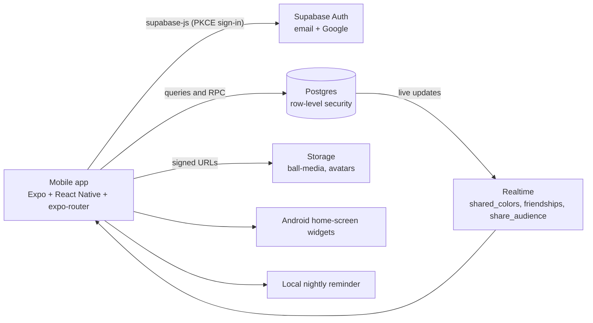
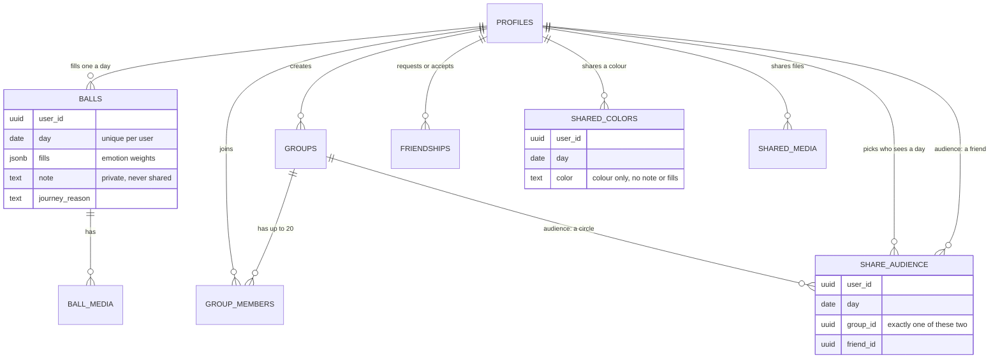

# Memory Lane

One orb a day, colored by how the day actually felt.

Fill a single memory orb each day by holding down the emotions you felt — they
draw from one shared pool, so a day only has so much weight to go around. The
orb blends into a glazed sphere, joins your private lane, and the days that
matter rise into Journey on their own.

## What's in it

- **Today** — hold-to-fill emotion picker over a shared 100% pool, with the orb
  re-blending live as you fill it
- **Compose** — optional photo, video, voice note and written note. All optional
  by design: a mandatory journal is the fastest way to make people skip a day
- **Lane** — every day from your first entry to today. Missed days stay visible
  as blanks rather than quietly disappearing
- **Journey** — days that spike (one emotion over 70%) or sprawl (5+ emotions at
  once) land here automatically; you can also pin any day yourself
- **Moments** — a month rolled up: days filled, the dominant feeling, the spread,
  its heaviest and lightest day
- **Looking back** — flashbacks to this calendar day in past months and years,
  plus one Journey day resurfacing on its own each day
- **Board** — two views. **Circles** are closed groups of up to 20 joined by
  invite code, and you can be in several. **Friends** are one-to-one, added by
  searching a name and accepting a request. Orbs appear live either way, and
  tapping one opens whatever that person shared. Every day is shared with an
  audience you pick — any mix of specific circles and specific friends. Your
  written note never leaves your lane
- **Profile** — a picture and a display name people recognise you by
- **Streak** — a plant that grows seed → sprout → sapling → young tree → full
  tree, and resets when the run breaks
- **Nightly reminder** — an optional nudge at a time you pick, automatically
  skipped on evenings you have already filled the day

## How it fits together



The app talks straight to Supabase. There is no server of our own, so **the
database policies are the security boundary**, not the app. That is why they
are tested (see `tests/db`).

### Data model



Three tables are deliberately separate. `balls` holds everything and is readable
only by its owner. `shared_colors` and `shared_media` have no column that could
carry a note or the emotion breakdown. `share_audience` says who may see a shared
day, and an empty audience means private. (`board_posts` from the first
migration is a leftover: the app no longer reads it.)

## Setup

### 1. Create a Supabase project

Go to [supabase.com](https://supabase.com), create a free project, then open the
SQL editor and run **all six** migrations in `supabase/migrations/`, in order:

| # | File | What it adds |
|---|---|---|
| 1 | `0001_init.sql` | profiles, balls (days), media, circles, board, row-level security, media bucket |
| 2 | `0002_friends_avatars_circles.sql` | friends, avatars, the shared-colour table, avatar bucket |
| 3 | `0003_shared_media.sql` | photos, video and voice notes shared with a day |
| 4 | `0004_share_audience.sql` | per-day audience (specific circles and friends) and `can_see_share` |
| 5 | `0005_fix_create_circle.sql` | fixes creating a circle |
| 6 | `0006_hardening.sql` | upload limits on the storage buckets, stronger invite codes with a lockout for guessing, delete-my-account, export-my-data and a keep-alive ping |

Skipping any of them leaves features broken: without 3 and 4, shared media and
audiences don't work, without 5 creating a circle fails, and without 6 there are no upload limits and no account deletion. Together they
create the tables, row-level security policies, the storage buckets, and turn
on realtime for the board.

### 2. Point the app at it

```bash
cp .env.example .env
```

Fill in the URL from **Project Settings → Data API** and the key from
**Project Settings → API Keys**:

```
EXPO_PUBLIC_SUPABASE_URL=https://your-project-ref.supabase.co
EXPO_PUBLIC_SUPABASE_ANON_KEY=sb_publishable_your-key-here
```

Use the **publishable** key (`sb_publishable_...`; older projects call this the
anon/public key). It is meant to ship inside the app — row-level security is
what actually protects the data, and every table has it enabled.

Never use the **secret** key (`sb_secret_...`, or `service_role` on older
projects). It bypasses row-level security completely and has no business in a
mobile app.

### 3. Turn on Google sign-in (optional but recommended)

Email and password work with no extra setup. Google is worth the fifteen
minutes: one tap instead of a password, and the app picks up the person's real
name and picture, so the board is readable immediately.

**In Google Cloud Console** ([console.cloud.google.com](https://console.cloud.google.com)):

1. Create a project, then go to **APIs & Services → OAuth consent screen**.
   Choose **External**, fill in an app name and your email, and save. While it
   stays in "Testing" you must add each friend under **Test users** — so once
   you are ready to hand it round, hit **Publish app**.
2. Go to **Credentials → Create credentials → OAuth client ID → Web
   application**.
3. Under **Authorised redirect URIs**, add your Supabase callback:
   `https://YOUR-PROJECT-REF.supabase.co/auth/v1/callback`
4. Copy the **Client ID** and **Client secret**.

**In Supabase:** Authentication → Sign In / Providers → **Google** → enable it,
paste the client ID and secret, save.

Also add the app's own redirect under Authentication → **URL Configuration →
Redirect URLs**: `memorylane://auth/callback`

Nothing to change in the code — the button is already on the sign-in screen. It
is shown whether or not the provider is configured, so until you finish the
steps above, tapping it returns an "unsupported provider" error.

### 4. Run it

```bash
npm install
npm start
```

Install **Expo Go** on your phone and scan the QR code. Phone and laptop need to
be on the same Wi-Fi. This is for developing — it only runs while the dev server
is up, so it is not how you hand the app to anyone else.

## Giving it to friends (Android)

This produces a real installable `.apk` with its own icon. No Play Store, no
fees, and it keeps working when your laptop is off.

```bash
npm install -g eas-cli
eas login                 # free Expo account
eas init                  # links this project, once
```

The app's Supabase values are baked in at build time, and `.env` is not uploaded
to EAS, so set them once as build-time environment variables:

```bash
eas env:create --environment preview --name EXPO_PUBLIC_SUPABASE_URL \
  --value "https://your-project-ref.supabase.co" --visibility plaintext
eas env:create --environment preview --name EXPO_PUBLIC_SUPABASE_ANON_KEY \
  --value "sb_publishable_your-key-here" --visibility plaintext
```

Then build:

```bash
eas build --platform android --profile preview
```

The build runs on Expo's servers (~10-15 minutes on the free tier) and ends with
a download link. Share that link — or the `.apk` itself — in the group chat.
Friends tap it, accept Android's "install from unknown source" prompt once, and
they're in.

To ship a fix later, rebuild and send the new link.

### iPhone friends

There is no free route. Apple requires a **$99/year** Developer Program account
to put an app on someone's iPhone via TestFlight. Until then, iPhone users can
run it through Expo Go with `eas update`, which works but lives inside Expo Go
rather than having its own icon.

## How privacy works here

Your written note and your emotion breakdown are readable only by you — enforced
by row-level security at the database, not just hidden in the UI. Nothing you
share ever carries them.

Sharing a day writes a color to `shared_colors` and, if you attached any,
references to your photos, video and voice notes to `shared_media`. Neither
table has a column that could carry your note or which emotions you picked.
Unsharing deletes both.

Who can read them is decided in the database, not the UI. Each shared day has an
audience in `share_audience` — the specific circles and specific friends you
ticked when you shared it. A day shared with one friend is readable by that
friend and nobody else, not even people in your circles. Every read goes through
`can_see_share`, including the signed URLs for media files, so a path leaking
out is not enough to open it.

An empty audience is the default and means private. There is no "everyone"
value — widening is always something you picked.

## Keeping the free database awake

A Free Supabase project is paused after a week without enough database
activity. Nothing is lost, but the app stops working until someone presses
**Resume** in the Supabase dashboard. Two ways to stop it:

1. **Upgrade to the Pro plan.** Paid projects are never paused. This is the
   only guaranteed fix.
2. **Use the keep-alive workflow (free, best effort).** Migration `0006` adds a
   `keep_alive()` function that makes one tiny write, and
   `.github/workflows/keep-alive.yml` calls it every three days.

   One-time setup, in the GitHub repo under **Settings → Secrets and variables →
   Actions**, add two repository secrets:

   | Secret | Value |
   |---|---|
   | `SUPABASE_URL` | `https://YOUR-PROJECT-REF.supabase.co` |
   | `SUPABASE_ANON_KEY` | the publishable key (`sb_publishable_...`), never the secret key |

   Then open the **Actions** tab, pick *Keep Supabase awake* and press **Run
   workflow** once. A green tick means the ping reached your database.

Two caveats. GitHub switches off scheduled workflows in a repo with no activity
for 60 days, so push a commit now and then (or press Run workflow). And Supabase
decides what counts as "enough activity", so this is not a guarantee. A free
alternative to GitHub is a scheduled `POST` to
`SUPABASE_URL/rest/v1/rpc/keep_alive` from a service such as cron-job.org, with
`apikey` and `Authorization: Bearer` headers set to the publishable key.

## Your data

**Profile → Export my data** saves everything the app holds about you as a JSON
file, including your private notes. **Profile → Delete my account** removes your
photos, videos and voice notes from Storage, then deletes your account and
everything tied to it (days, friendships, circle memberships). Circles you
created are handed to another member, or deleted if you were the only one in
them. It cannot be undone.

## Accessibility

Every control announces itself as a button, selectable chips and rows report
whether they are selected, and photo previews and remove buttons have spoken
labels. The hold-to-fill emotion picker also works without holding: with a
screen reader on, swipe up or down on an emotion to add or remove 5%.

## Commands

```bash
npm start          # Expo dev server
npm run typecheck  # tsc --noEmit, for the app and the tests
npm test           # unit tests (Vitest) for the pure logic in src/lib
npm run android    # open on Android
npm run ios        # open on iOS (needs macOS)
```

## Stack

Expo SDK 57 · React Native 0.86 · expo-router · TypeScript · Supabase
(Postgres + Auth + Storage + Realtime) · react-native-svg for the orb and plant
